# SOFTWARE DESIGN SPECIFICATION (SDS)

## PRIVACY68: Windows Voice Assistant and Desktop Automation

**A.J. Institute of Engineering & Technology, Mangaluru**
**Department of MCA**

| Document field | Value |
|---|---|
| Project | PRIVACY68 |
| Document | Software Design Specification |
| Version | 1.0 |
| Prepared on | 24 October 2026 |
| Prepared by | _Add student name(s) and USN(s)_ |
| Guide | _Add guide name_ |
| Project category | Software system with pretrained ML inference components; no project-owned model training |
| Repository version reference | 1.4.3 (project metadata) |

> **Scope and accuracy note:** This specification describes the checked-in implementation, not planned or advertised features. PRIVACY68 is primarily a Windows desktop application. It uses pretrained speech and speaker-recognition models for inference, but the repository contains no dataset preparation, training, evaluation-split, experiment-tracking, or model-registry pipeline. Model training sections below therefore document the actual inference and enrollment design and explicitly mark training-only items as not applicable.

---

## 1. System Design

### 1.1 Architectural Design

PRIVACY68 is a Windows desktop voice assistant that combines speech processing, a desktop control center, and computer automation in one Python application. Users can give commands through the microphone or dashboard, review runtime information, manage plugins, and control supported computer functions. The application uses Faster-Whisper for speech recognition and an ONNX speaker-recognition model for optional Voice Lock; these speech and speaker-processing components run locally.

The system coordinates requests through a command executor. Greetings and pending confirmations are handled directly, explicit GitHub requests are routed to the GitHub integration, and other requests are sent to the Agent Brain. The GitHub integration uses the GitHub REST API for repository, issue, and pull-request tasks and local Git for repository status and confirmed branch pushes. Its personal access token is stored in Windows Credential Manager. For other requests, the Agent Brain sends command text through LiteLLM to its configured model and executes returned Python code in a subprocess, so the provider may be remote and generated code runs with the current user's permissions.

PRIVACY68 does not use a central SQL database. User preferences and voice-profile data are stored in local JSON and NumPy files, while the GitHub token is stored separately in Windows Credential Manager. The architecture connects the user interfaces, speech pipeline, command routing, plugins, local Windows operations, and external services while keeping their responsibilities distinct.

#### 1.1.1 System Context Diagram

The user interacts with PRIVACY68 through a microphone, the Windows desktop interface, or (when enabled) a browser on the local network. Speech-to-text and speaker verification execute locally. The Agent Brain sends text to the provider/model configured in its source (`ollama/gemma4:31b-cloud` at the time of this specification) through LiteLLM and receives generated Python code. Explicit GitHub tasks use the GitHub REST API and local Git; their personal access token is kept in Windows Credential Manager. The provider may be local or remote depending on its configuration and deployment; the application must not be described as air-gapped unless the selected endpoint is verified to be local.

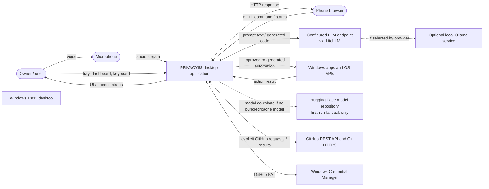

**Trust boundaries:** microphone audio enters the local process; the Agent Brain currently hard-codes the model identifier `ollama/gemma4:31b-cloud` and does not read the provider/model values saved by the dashboard. Treat command text and the system prompt as potentially leaving the machine until the provider's actual routing is verified. Generated code executes with the user's Windows account permissions. The GitHub integration sends authenticated requests to GitHub; protect the Windows account and grant the token only required repository permissions. The remote HTTP server currently defaults to `0.0.0.0` and does not implement request authentication. LAN access therefore exposes a control surface and must be treated as a security boundary, not as a private authenticated API.

**Routing note:** the implementation does not use a three-lane architecture. The executor handles pending security confirmations and greeting shortcuts, routes explicit GitHub requests to the GitHub plugin, and sends remaining requests to the Agent Brain. The GitHub plugin uses the GitHub API for account/repository tasks and local Git for repository status and confirmed branch pushes.

#### 1.1.2 High-Level Architecture

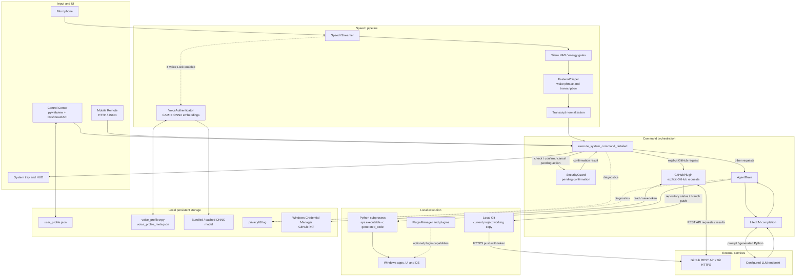

**Primary entry point:** `app.py` starts the tray, remote server, speech streamer, and HUD. `--dashboard` or `--settings` launches the Control Center. The separate `main.py` contains an older, simplified assistant loop and is not the main application startup path.

**End-to-end ML pipeline (inference-only in this project):**

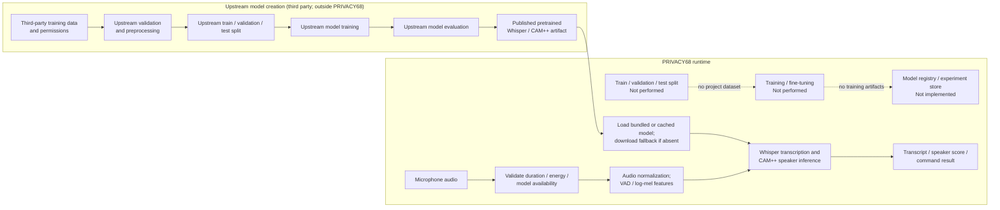

PRIVACY68 performs runtime inference and user-specific speaker enrollment only. Upstream training data, split ratios, model training parameters, validation metrics, and model-registry records are not part of this repository and must be obtained from the respective model publishers if required for the academic report.

**Data location summary:** microphone audio and transcripts are processed at runtime; this SDS does not describe them as a retained dataset. Voice Lock persists embeddings and metadata in local NumPy/JSON files. User preferences are stored in the local profile JSON. The GitHub PAT is stored separately in Windows Credential Manager. The project working tree and Git history remain in the local repository. GitHub repository, issue, and pull-request data remain on GitHub and are fetched only when requested. LLM prompts and generated code are sent to the configured model endpoint; whether that endpoint is local or remote depends on deployment.

#### 1.1.3 Subsystems / Components and Responsibilities

| Subsystem | Main implementation | Responsibility |
|---|---|---|
| Application bootstrap | `app.py`, `config.py` | Initializes logging, UI, remote server, speech streamer, and callbacks. Selects audio/model configuration and starts worker threads. |
| Audio capture and wake detection | `speech/streamer.py` | Captures mono audio at configured sample rate, streams chunks, applies energy/VAD gates, uses Whisper-based wake phrase detection, and dispatches recognized text. |
| Speech activity detection | `speech/vad.py` | Provides Silero VAD functionality used by the speech pipeline. |
| Speech recognition | `faster-whisper` accessed from `speech/streamer.py` | Transcribes wake phrases and commands. `config.py` selects `medium.en`, CUDA/float16 when detected, otherwise CPU/int8. |
| Voice Lock | `speech/voice_auth.py` | Preprocesses audio, computes 80-bin log-mel features, invokes a CAM++ ONNX model, creates 512-dimensional embeddings, enrolls a profile, and compares speakers. |
| Command execution | `actions/executor.py` | Cleans text, handles pending confirmation and greeting shortcuts, routes explicit GitHub commands to the GitHub plugin, dispatches remaining commands to the Agent Brain, and emits callbacks. |
| Security confirmation | `computer_use/security_guard.py` | Classifies named actions into risk levels, queues sensitive/critical actions, expires pending actions after 15 seconds, and records an in-memory audit list. |
| Agent Brain | `actions/agent_brain.py` | Sends user text to LiteLLM, extracts Python from the model response, then invokes it using a Python subprocess with a 30-second timeout. |
| Plugin framework | `plugins/base_plugin.py`, `plugins/manager.py`, `plugins/*_plugin.py` | Defines the plugin interface, registers built-in GitHub/Chrome/System/WhatsApp plugins, and loads user Python plugins from the application-data directory. The dashboard can list, toggle, install, create, and uninstall user plugins. |
| GitHub integration | `plugins/github_plugin.py`, `computer_use/security_guard.py` | Stores a PAT in Windows Credential Manager, accesses repositories/issues/pull requests through the GitHub REST API, reports local Git status, and pushes the checked-out branch after confirmation. |
| User profile | `plugins/profile_manager.py` | Reads and writes settings as JSON under `%APPDATA%\PRIVACY68\user_profile.json` (or the home directory fallback). |
| Desktop UI | `ui/manager.py`, `ui/hud.py`, `ui/tray.py` | Displays listening, processing, success, and error states and exposes tray actions. |
| Control Center | `ui/dashboard_runner.py`, `ui/dashboard_bridge.py`, `ui/dashboard/index.html` | Starts a pywebview window and exposes settings, diagnostics, model connection tests, plugin management, GitHub token connection, and voice-enrollment operations to JavaScript. |
| Mobile Remote | `server/remote_server.py`, `server/static/` | Serves a mobile web page and HTTP status, QR, quick-action, and command endpoints. |
| Acceleration utilities | `utils/cuda_manager.py` | Detects/configures CUDA DLL availability for supported inference workloads. |

#### 1.1.4 Data Flow and Component Communication

1. `SpeechStreamer` receives microphone blocks (16 kHz, mono, float32 according to `config.py`).
2. While idle, it applies energy/no-speech checks and transcribes rolling audio windows to detect a configured wake word.
3. After wake detection, it collects command audio, applies VAD/silence handling, and—if Voice Lock is enabled—verifies the speaker before transcribing the command with Faster-Whisper.
4. The callback in `app.py` updates the HUD and invokes `execute_system_command`.
5. `actions/executor.py` normalizes the transcript and checks for a pending confirmation. Confirmation words execute a queued action and cancellation words discard it. Other requests are not allowed to replace an action while its confirmation is pending.
6. A greeting returns locally. Explicit GitHub requests are parsed and routed to `GitHubPlugin`; other requests go to `AgentBrain.generate_and_execute`.
7. The GitHub plugin uses Windows Credential Manager for the PAT. Read requests use GitHub REST API endpoints; local status reads the current repository, and a branch push uses Git with a temporary askpass helper. Push, issue creation, and pull-request creation require an explicit confirmation.
8. `AgentBrain` calls `litellm.completion`, extracts Python source, then executes the source using `subprocess.run([sys.executable, "-c", code], timeout=30)`.
9. Results are returned to the UI callbacks and shown in the HUD/tray. The remote endpoint similarly dispatches command text through a callback and returns JSON.
10. Voice Lock uses the ONNX model to map enrollment and verification audio to embeddings. The voice profile stores embeddings and metadata rather than the original enrollment audio.

**Communication mechanisms:** in-process Python calls and callbacks; WebView JavaScript-to-Python bridge; HTTP/JSON over the configured remote server; LiteLLM provider interface; ONNX Runtime inference; and subprocess execution of generated code.

#### 1.1.5 Design Alternatives and Decisions

| Decision | Alternative considered | Rationale / trade-off |
|---|---|---|
| Desktop-first Windows application | Browser-only application | A desktop process is required for microphone streaming, tray/HUD behavior, and Windows automation. |
| Faster-Whisper for ASR | Cloud speech recognition | Local ASR avoids sending raw audio to a speech API and avoids network round trips; it uses local CPU/GPU resources. |
| ONNX speaker model | Train a project-owned speaker network | A pretrained ONNX model avoids operating a training pipeline. Accuracy, model licensing, and threshold calibration remain external responsibilities. |
| JSON and NumPy local files | Relational database | Current settings and one owner's voice profile are small local records; a database would add complexity. This is not suitable for multi-user analytics or query history. |
| HTTP remote bridge | WebSocket service | The current protocol is a small synchronous command/status API. HTTP is simple to use from a mobile browser; the current implementation still needs authentication and network restriction before exposure to untrusted networks. |
| LLM-generated Python | Fixed intent-only router | Code generation supports flexible requests but introduces prompt-injection, correctness, and execution risks. The current subprocess execution is not a sandbox. |

---

## 2. Detailed Design

### 2.1 Dataset Design

#### 2.1.1 Dataset Provenance and Permissions

PRIVACY68 does not create or train a custom machine-learning dataset. It consumes live audio transiently for recognition and speaker verification and uses a third-party pretrained speaker-recognition model.

| Data / model | Source and owner | License / permission | Collection period | Intended use |
|---|---|---|---|---|
| Live microphone audio | Captured from the device microphone after the user starts the application or voice enrollment | User/device owner must authorize microphone access. No project dataset license applies. | Per command or enrollment recording | Local ASR, wake phrase recognition, and speaker embedding inference. |
| Voice enrollment samples | Recorded from the user through the Control Center; enrollment captures approximately 3 seconds per sample | Requires explicit informed consent from the person being enrolled. The repository does not include third-party speaker data. | At enrollment and when re-enrolled | Creates a local speaker profile for matching. The application stores embedding vectors, not the enrollment waveforms, in the normal Voice Lock flow. |
| Bundled speaker model | `assets/models/speaker_model.onnx`; the source code identifies the upstream model family as WeSpeaker CAM++ (`Wespeaker/wespeaker-voxceleb-campplus-LM`) | Confirm the upstream model card and redistribution terms before academic or public redistribution. The repository does not establish a separate model license in this SDS. | Pretrained before use; downloaded only if bundled and cached models are unavailable | Local speaker embedding inference. |
| Speech recognition model | Faster-Whisper downloads/loads the selected Whisper model through its runtime | Follow the model provider's model-card/license terms for the exact selected model. | Pretrained before use | Local English speech recognition and wake phrase detection. |
| User settings | Entered by the user in the dashboard or read from local profile file | User-provided; API credentials should be treated as secrets | Updated when settings are saved | Wake word, provider/model configuration, thresholds, preferences, and credentials. |
| GitHub personal access token | Entered by the user in the dashboard; validated with GitHub | User-created token; grant only required fine-grained repository permissions and set an expiration | Stored until disconnected/revoked | GitHub REST API access and authenticated HTTPS Git push. Stored in Windows Credential Manager, not the profile JSON. |
| Command text / LLM output | Generated from the user's typed or recognized request and configured LLM response | User command content; provider terms apply if the configured endpoint is remote | Per request | Code generation and desktop task execution. |

**Permissions and privacy controls:** provide a clear consent step before enrollment, explain local storage and deletion, and do not enroll another person's voice without permission. Model/provider credentials in the profile JSON remain ordinary JSON and require protection of the Windows account and profile directory. The GitHub token is stored separately in Windows Credential Manager and can be removed from the dashboard; revoke it on GitHub when no longer needed. The current remote server has no authentication; do not expose it to the public Internet.

#### 2.1.2 Dataset Schema and Data Dictionary

There is no consolidated dataset file. The table describes runtime records and persisted artifacts.

| Field / artifact | Type / shape | Meaning | Permissible range / format | Missingness | Sensitivity |
|---|---|---|---|---|---|
| Audio block | float32 array, 1-D block | Transient microphone samples | Nominal amplitude `[-1, 1]`; 16,000 samples/sec; mono | Empty blocks may occur on capture failure | High: raw voice is personal data |
| Transcript | UTF-8 string | Recognized or typed command text | Non-empty for command dispatch; variable length | Empty transcript is ignored/rejected | High if it contains personal or private content |
| `user_name` | JSON string | Display/enrollment owner name | Any user-entered string | Defaults to `User` | Personal data |
| `assistant_name` | JSON string | Assistant display name | Any user-entered string | Defaults to `Privacy68` | Low |
| `wake_word` | JSON string | Wake phrase or comma-/slash-separated alternatives | Non-empty phrase recommended | Defaults to `privacy68` | Low |
| `wake_threshold` | JSON number | Wake detection setting | Default `0.50`; application behavior should be checked before changing | Defaults supplied by profile manager | Low |
| `voice_lock_enabled` | JSON boolean | Enables speaker verification gate | `true` / `false` | Defaults to `false` | Security setting |
| `voice_lock_threshold` | JSON number | Cosine similarity threshold used for verification | Dashboard clamps threshold to `[0.40, 0.95]`; default `0.50` | Defaults supplied by profile manager | Security setting |
| `llm_provider`, model/base URL | JSON strings | Provider and model endpoint configuration | Provider-specific strings / URLs | Defaults supplied by profile manager | Configuration sensitivity |
| `api_key` | JSON string | Provider credential | Secret token; no application-level encryption in current writer | Empty by default | Critical secret |
| `voice_profile.npy` | NumPy float32 array, typically `(N, 512)` | Enrolled speaker embeddings | Finite vectors; each embedding is normalized before storage | Absent until successful enrollment | High: biometric-derived data |
| `voice_profile_meta.json` | JSON object | Owner label, sample count, creation time, model name, embedding dimension | `dim` currently `512`; sample count depends on enrollment | Absent until enrollment | High: biometric metadata |
| ONNX speaker model | Binary ONNX model | Pretrained weights | Must be a readable ONNX file accepted by ONNX Runtime | Bundled model preferred; cached/download fallback | Third-party model/IP |
| Application log | UTF-8 text | Runtime diagnostic messages | Rotating/size policy is not implemented in the shown bootstrap | May be absent until app start | May include transcripts or error details; review before sharing |

**Retention note:** the main streaming path keeps audio in memory while processing. The legacy standalone `main.py` writes `temp_cmd.wav` and does not remove it in the code shown; use the primary `app.py` entry point or add explicit deletion before claiming all raw audio is ephemeral.

#### 2.1.3 Target / Label Definition

There is no supervised target label or project-trained classifier. Voice Lock performs **speaker verification**, not general speech classification:

- The claimed identity is the enrolled local owner profile.
- Positive examples are enrollment utterances from the consenting owner; no project-managed negative-speaker dataset is included.
- Verification produces a cosine-similarity score and compares it against the selected threshold (default `0.50`).
- The threshold is a configurable operating point, not a validated false-accept/false-reject guarantee.
- The transcript is an ASR output and is not a machine-learning label.

For a research evaluation, collect a consented, licensed test corpus with distinct enrollment and verification sessions, define speaker-disjoint partitions, report false acceptance/rejection and equal-error rate, and document microphone/noise conditions. Do not use the three enrollment samples as a claimed independent test set.

#### 2.1.4 Partitioning and Leakage Prevention

Training/validation/test proportions are **not applicable** to the current product because no model is trained in this repository. The three voice-enrollment recordings are used to build the active profile; they are not split into train and test partitions. This is enrollment, not model training.

If a future version trains or fine-tunes a model:

1. Obtain documented consent and dataset redistribution rights before ingestion.
2. Split by speaker (and, when relevant, by session/time) so recordings from one identity/session do not appear in both training and evaluation.
3. Deduplicate recordings before splitting.
4. Keep a fixed, untouched test set and record dataset/model versions and random seeds.
5. Never include API keys, personal command transcripts, or real biometric profiles in training data without explicit authorization.

### 2.2 Preprocessing and Feature Engineering

#### 2.2.1 Validation and Cleaning

**Speech command path**

- Input is expected to be a mono audio stream at 16 kHz.
- The stream applies RMS/peak energy gates and a Silero VAD path to avoid transcribing silence/noise.
- Whisper uses the configured language, hotwords, initial prompt, beam size, and hardware mode from `config.py`.
- `autocorrect_speech_command` removes common filler words, repeated adjacent words, trailing conjunction/prepositions, selected ASR misspellings, and excess whitespace.
- Empty/whitespace-only commands are rejected.

**Voice verification path**

- Convert incoming audio to flattened float32.
- Remove DC offset.
- Apply an 80 Hz high-pass Butterworth filter when filter construction succeeds.
- Normalize RMS toward `0.10`, capped at 25x gain, then soft-limit the peak to `0.95`.
- Trim low-energy leading/trailing regions using 20 ms frames and a data-derived energy threshold.
- Reject too-short audio for embedding extraction (less than approximately 100 ms).
- Feature extraction uses 25 ms frames, 10 ms frame shift, 512-point FFT, Povey window, 80-bin log-mel filterbanks, and cepstral mean normalization.
- The model returns a 512-dimensional embedding, which is L2-normalized.

**Failures:** model-load, audio-device, or inference errors should be surfaced in logs and the UI. A missing/invalid speaker model means Voice Lock cannot verify a speaker; it must not be represented as a successful match.

#### 2.2.2 Feature Selection / Extraction

| Component | Features / representation | Rationale |
|---|---|---|
| ASR | Audio waveform consumed by Faster-Whisper | End-to-end speech recognition; this repository does not hand-engineer ASR input features. |
| Wake phrase | Whisper transcript + regex aliases/fuzzy string comparison | Supports configurable names, common spoken number forms, and transcription variations without a separate wake-word model. |
| Speaker verification | 80-channel log-mel filterbank input; 512-dimensional unit-normalized CAM++ embedding output | Represents speaker characteristics for cosine-similarity comparison. |
| Command normalization | Cleaned text string | Removes common transcription artifacts before routing. |
| LLM code generation | System prompt + normalized user request | Requests executable Python from the configured LLM. No local learned intent classifier is present in the current `actions/` implementation. |

### 2.3 Model Design

#### 2.3.1 Baseline and Candidate Models

| Task | Current implementation | Alternatives / baseline | Selection and limitation |
|---|---|---|---|
| Speech-to-text | Faster-Whisper using the configured Whisper model; `medium.en` is set in `config.py` | Smaller Whisper model for lower resource use; a remote ASR API | Local inference avoids uploading raw audio, but requires local compute and model files. The legacy `main.py` independently initializes `tiny`; document this as a legacy path, not the primary configuration. |
| Voice activity detection | Silero VAD plus energy/silence gates | RMS-only thresholding | Neural VAD can distinguish speech from some background conditions better than a single energy threshold; runtime behavior remains environment-dependent. |
| Wake phrase detection | Whisper transcript followed by regex aliases and fuzzy string matching | Dedicated keyword spotting model | Reuses transcription and permits flexible configured phrases, at the cost of transcription latency and possible false triggers. |
| Speaker verification | Pretrained CAM++ ONNX model; cosine similarity against locally enrolled embeddings | No Voice Lock; another pretrained speaker-embedding model | ONNX Runtime supports local CPU inference and the bundled model avoids a first-run download when present. No comparative benchmark is included. |
| Command reasoning | LiteLLM completion configured as `ollama/gemma4:31b-cloud` in `AgentBrain` | Deterministic intents or another local/remote model | Supports flexible natural-language commands. Provider routing may be remote; model selection and privacy properties must be validated for each deployment. |

#### 2.3.2 Model Architecture

**Speech / speaker inference pipeline**

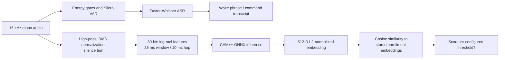

The application does not expose network depth, layer widths, or train-time hyperparameters for the pretrained model in source. These must be taken from the exact upstream model card and checked against the bundled file before publication. Do not infer architecture details from the filename alone.

**Agent Brain pipeline**

```mermaid
flowchart LR
    Text[Normalized command text]
    Prompt[System prompt + user request]
    Provider[LiteLLM completion\nconfigured model/provider]
    Response[LLM response]
    Extract[Remove optional Markdown fence]
    Code[Generated Python source]
    Exec[Python subprocess\n30-second timeout]
    Result[stdout / stderr / return code]

    Text --> Prompt --> Provider --> Response --> Extract --> Code --> Exec --> Result
```

Generated code runs as the current user in a child Python process. The current implementation does not provide an operating-system sandbox, AST allowlist, human preview/approval step, resource quota beyond a timeout, or filesystem/network isolation.

### 2.4 Database Design

#### 2.4.1 ER Diagram / Storage Architecture

PRIVACY68 does **not** use a relational database. Its current data needs are local preferences and a single user's speaker profile, so it stores JSON and NumPy files under the user's application-data directory. This design is simple for a single-machine desktop application but does not provide transactional updates, relational constraints, multi-user access control, or queryable command history.

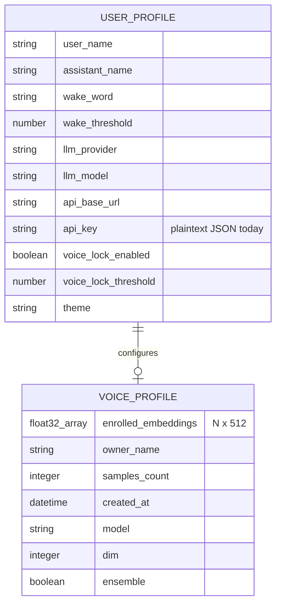

`USER_PROFILE` maps to `%APPDATA%\PRIVACY68\user_profile.json`; `VOICE_PROFILE` maps to `%APPDATA%\PRIVACY68\voice_profile.npy` and `voice_profile_meta.json`. The speaker model is stored in the application bundle or model cache, not in a relational table. Logs are stored separately. There is no persistent `COMMAND`, `PREDICTION`, `EXPERIMENT`, or `MODEL_VERSION` table in the current implementation.

#### 2.4.2 Schema

The profile JSON defaults are defined by `ProfileManager`; additional keys can be merged into the same object. The voice metadata stores the model label and embedding dimension. The schema is application-defined rather than enforced by a database engine.

| Logical entity | Physical storage | Relationship / lifecycle |
|---|---|---|
| User settings | `%APPDATA%\PRIVACY68\user_profile.json` | One per Windows user; settings are loaded at startup and rewritten on `set` / `update_multiple`. |
| Voice profile | `%APPDATA%\PRIVACY68\voice_profile.npy` | Optional one-to-one with settings; created after enrollment; removed by reset. Contains speaker embeddings. |
| Voice metadata | `%APPDATA%\PRIVACY68\voice_profile_meta.json` | Describes the corresponding voice profile and model dimensions. |
| Speaker model | `assets/models/speaker_model.onnx`; optional cache under `%APPDATA%\PRIVACY68\models` | Shared inference artifact, not user profile data. |
| Application log | `%APPDATA%\PRIVACY68\privacy68.log` | Diagnostic output; no structured retention/rotation policy is defined in the application bootstrap. |
| Pending action / audit | Process memory | One pending confirmation and an in-memory bounded audit list; lost on process exit. |
| Command history | Not persisted by core backend | The mobile client may maintain browser-side UI history; it is not a backend database record. |

### 2.5 UML and Behavioral Design

#### 2.5.1 Use-Case Diagram

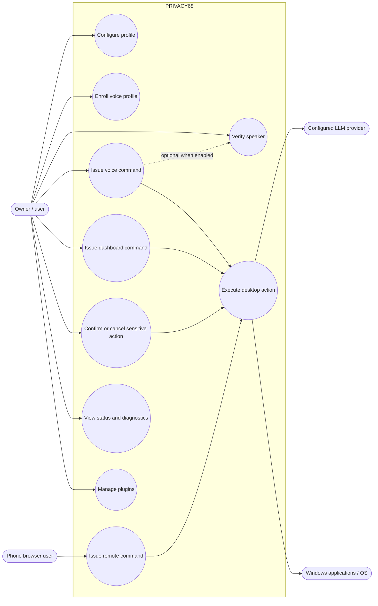

| Use case | Primary actor | Preconditions | Main outcome |
|---|---|---|---|
| Configure profile | Owner | Dashboard is open | Settings are written to the local JSON profile. |
| Enroll voice profile | Owner | Microphone available; speaker model loaded | Up to three samples are converted into embeddings and saved; Voice Lock is enabled after finalization. |
| Verify speaker | Owner | Voice Lock is enabled and a profile is available | Live speaker score is compared with configured threshold. |
| Issue voice command | Owner | Application and microphone are running | Speech is transcribed, normalized, dispatched, and the result is surfaced in HUD/tray. |
| Issue dashboard command | Owner | Control Center is open | Dashboard bridge dispatches command; current bridge implementation should be validated because it calls `agent_brain.run`, while the current `AgentBrain` exposes `generate_and_execute`. |
| Issue remote command | Phone browser user | Remote server running and reachable | HTTP endpoint forwards text to executor and returns JSON. Current endpoint has no authentication. |
| Confirm/cancel pending action | Owner | A caller has queued an action with `SecurityGuard` and it has not expired | Action executes once on confirmation or is discarded on cancellation/timeout. The generic generated-code path does not automatically queue sensitive actions. |
| View status/diagnostics | Owner | Dashboard open | Returns local status, model, microphone, plugin, or CUDA data where implemented. |
| Manage plugins | Owner | Dashboard/plugin manager available | Lists registered plugins, toggles registry state, creates a starter plugin, installs `.py` files, and removes user plugin files. Built-ins are protected from uninstall. |

#### 2.5.2 Class / Component Diagram

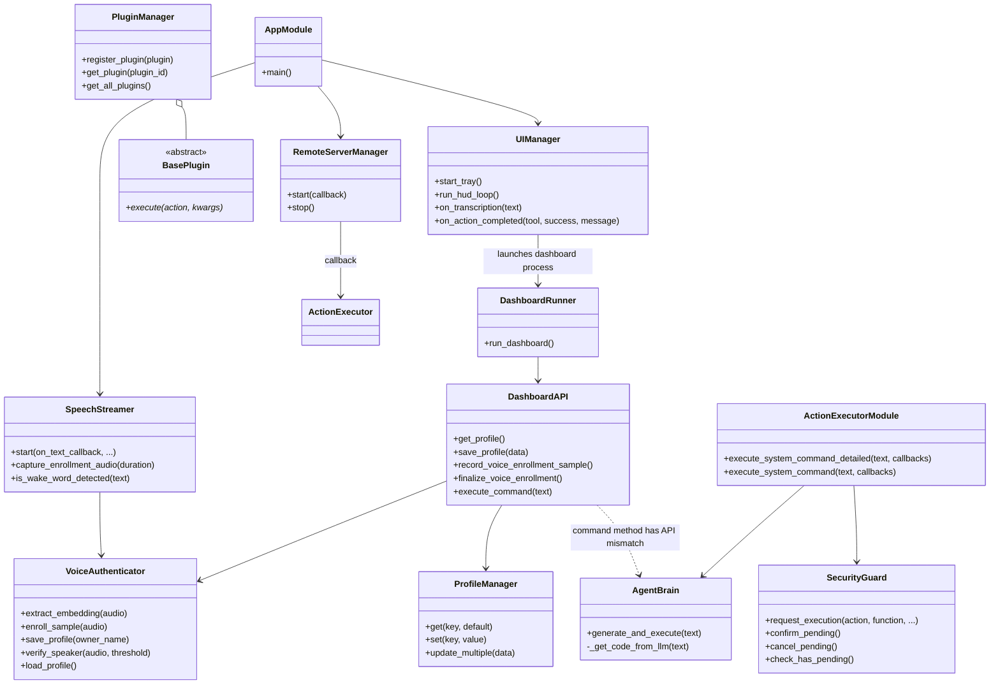

#### 2.5.3 Sequence Diagrams for Critical Flows

**Voice command and generated action**

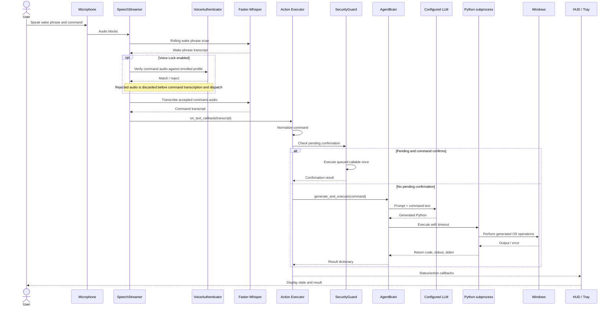

**Voice enrollment and verification**

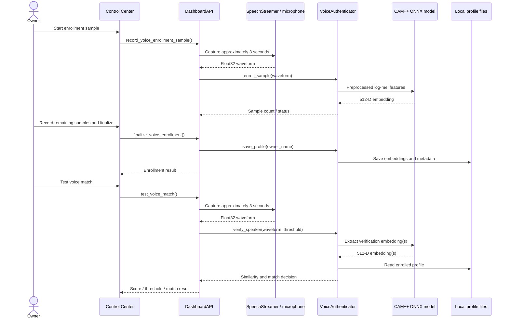

#### 2.5.4 Activity Diagram

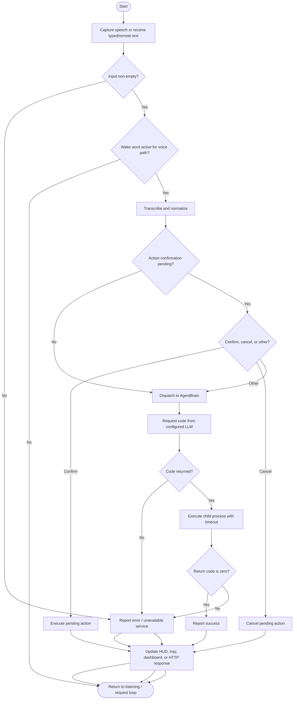

### 2.6 User Interface Design

#### 2.6.1 Main Interfaces

| Interface | Purpose | Main controls / output |
|---|---|---|
| Floating HUD | Always-available visual state of the assistant | Idle, listening, processing/agent, success, and error states; audio-energy visualization. |
| System tray | Background control | Dashboard, mute/listening toggle, plugin reload and shutdown-related actions. |
| Control Center | Desktop settings and diagnostics | Profile and wake-word settings, command console, reasoning/code areas, system/model status, plugin management, microphone and Voice Lock tools. |
| Mobile Remote | Browser-based local-network control | Command entry, quick actions, connection status, QR pairing endpoint, and command result history. |

#### 2.6.2 Screenshots

The images below are screenshots of the checked-in interface rendered in a browser for documentation. The Control Center uses representative bridge data for layout; its model and hardware values are illustrative rather than a live measurement. The Mobile Remote image was captured from a local running HTTP server with the host name and IP replaced by example values.

**Control Center desktop view**

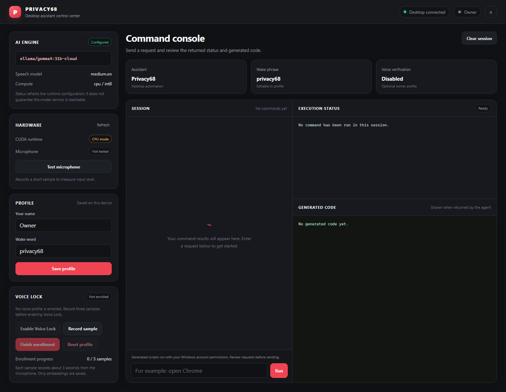

**Mobile Remote view**

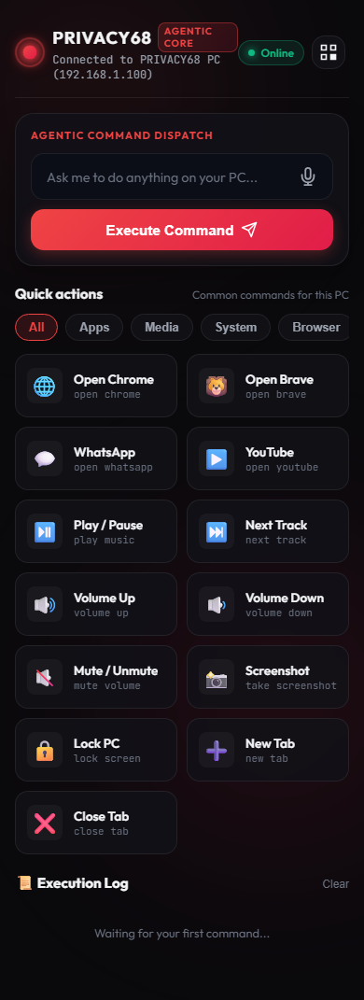

#### 2.6.3 UI Design Notes

- The Control Center uses a dark, high-contrast interface with red accent colors and a left-side status/profile panel.
- Runtime provider/model values and hardware state are populated by the Python bridge; a configured model identifier does not guarantee that its service is reachable.
- The main area presents the command console alongside reasoning and generated-code panels.
- The Mobile Remote uses a responsive command card and quick-action/status sections suitable for a phone browser.
- The HUD is a native overlay rather than an HTML page. Capture a runtime HUD screenshot on Windows and replace/add an image if the department requires screenshots of every screen.
- Screenshots demonstrate layout only; they do not prove model connectivity, microphone functionality, or action execution.

---

## 3. References

1. A.J. Institute of Engineering & Technology, Department of MCA. *Software Design Specification (SDS) template for ML and non-ML projects*, supplied format.
2. PRIVACY68 source code: `app.py`, `config.py`, `actions/`, `computer_use/`, `plugins/`, `speech/`, `server/`, and `ui/`.
3. Faster-Whisper project documentation: <https://github.com/SYSTRAN/faster-whisper>.
4. OpenAI Whisper repository and model information: <https://github.com/openai/whisper>.
5. Silero VAD project: <https://github.com/snakers4/silero-vad>.
6. WeSpeaker project and pretrained model information: <https://github.com/wenet-e2e/wespeaker> and <https://huggingface.co/Wespeaker/wespeaker-voxceleb-campplus-LM>. Confirm the precise bundled model license and model-card version before redistribution.
7. ONNX Runtime documentation: <https://onnxruntime.ai/docs/>.
8. LiteLLM documentation: <https://docs.litellm.ai/>.
9. Mermaid diagram syntax: <https://mermaid.js.org/>.
10. Python `subprocess` documentation: <https://docs.python.org/3/library/subprocess.html>.

---

## Appendix A. Prompt for Regenerating or Extending the Diagrams

Use this prompt with a diagram-capable assistant/editor. The Mermaid diagrams above are already the project-specific diagrams and should be treated as the source of truth.

> **Prompt:**
> “Create clear, technically accurate software-design diagrams for the PRIVACY68 Windows voice-assistant project using Mermaid. Use only facts in the supplied SDS and repository files; do not invent modules, databases, model-training stages, authentication, encryption, or capabilities. Produce: (1) a system context diagram showing the owner, microphone, Windows PC, phone browser, configured LLM provider, optional local Ollama, Windows applications, and model download source; (2) a component/architecture diagram showing the actual Python modules and data stores; (3) a speech and speaker-verification inference pipeline, explicitly showing that the project does not train a model; (4) a use-case diagram; (5) a class/component relationship diagram; (6) sequence diagrams for voice command execution and voice enrollment/verification; (7) an activity diagram with invalid input, confirmation, cancellation, LLM failure, execution success, and execution failure. Use readable labels and directional arrows. Mark external or conditional services as such. Show that the remote server currently has no authentication and that generated Python executes in a subprocess with the current user's permissions. Return Mermaid source code only, with one labeled code block per diagram.”

## Appendix B. Items to Verify Before Final Academic Submission

- Add student name(s), USN(s), guide name, semester, and institutional submission date to the cover table.
- Confirm exact license and redistribution conditions for the bundled CAM++ ONNX file and the selected Faster-Whisper model.
- Test and record actual hardware, model/provider, operating-system version, and threshold used in the demonstration.
- Replace screenshot placeholder values with screenshots captured from a running application if required by the evaluator.
- Do not state that API keys are encrypted or that all LLM processing is air-gapped: the current profile writer uses JSON and the Agent Brain may target a remote provider.
- Fix or document the dashboard command bridge mismatch (`DashboardAPI.execute_command` calls `agent_brain.run`, while `AgentBrain` currently exposes `generate_and_execute`) before claiming the dashboard command path is operational.
- Treat the mobile remote as trusted-LAN-only until authentication, request limits, and a safer default bind address are implemented.
