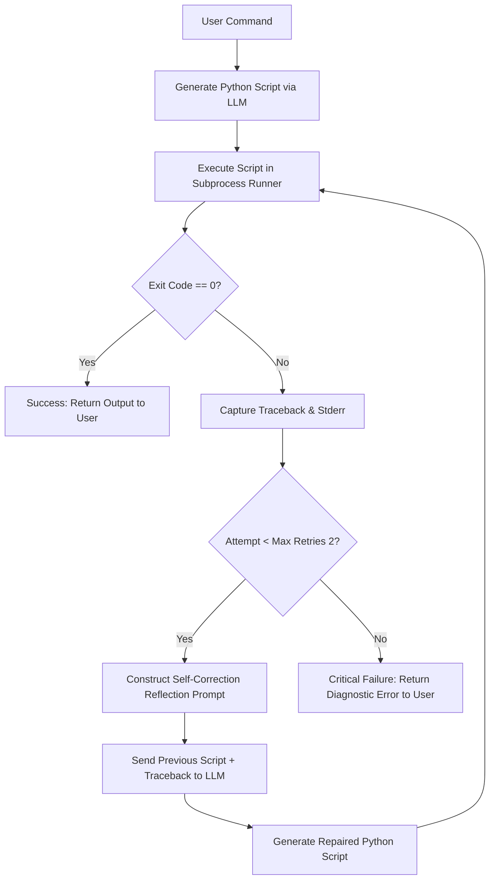

# PRIVACY68 // AI ENGINE & OPENCLAW SKILLS ARCHITECTURE

```
  █████╗ ██╗    ███████╗███╗   ██╗ ██████╗ ██╗███╗   ██╗███████╗
 ██╔══██╗██║    ██╔════╝████╗  ██║██╔════╝ ██║████╗  ██║██╔════╝
 ███████║██║    █████╗  ██╔██╗ ██║██║  ███╗██║██╔██╗ ██║█████╗  
 ██╔══██║██║    ██╔══╝  ██║╚██╗██║██║   ██║██║██║╚██╗██║██╔══╝  
 ██║  ██║██║    ███████╗██║ ╚████║╚██████╔╝██║██║ ╚████║███████╗
 ╚═╝  ╚═╝╚═╝    ╚══════╝╚═╝  ╚═══╝ ╚═════╝ ╚═╝╚═╝  ╚═══╝╚══════╝
```

---

## 1. Multi-Provider Cascading Topology

To guarantee uninterrupted 24/7 desktop availability without crashing on rate limits or API outages, PRIVACY68 coordinates multi-provider LLM inference through `LiteLLM` in [actions/agent_brain.py](file:///d:/projects/PRIVACY68/actions/agent_brain.py).

### Hierarchy of AI Models

```
┌──────────────────────────────────────────────────────────────┐
│  Tier 1 (Default): Google Gemini 3.1 Flash-Lite              │
│  Model: gemini/gemini-3.1-flash-lite                         │
│  Latency: ~300ms - 550ms | Cost: Ultra-low / Free quota      │
└──────────────────────────────┬───────────────────────────────┘
                               │  (On 429 Rate Limit / Timeout)
┌──────────────────────────────▼───────────────────────────────┐
│  Tier 2 (Failover 1): Groq LPU Hardware Acceleration         │
│  Model: groq/llama-3.3-70b-versatile                         │
│  Latency: ~180ms - 280ms | Ultra-fast token throughput       │
└──────────────────────────────┬───────────────────────────────┘
                               │  (On 429 / Outage)
┌──────────────────────────────▼───────────────────────────────┐
│  Tier 3 (Failover 2): Anthropic Claude 3.5 Sonnet            │
│  Model: claude-3-5-sonnet-20241022                           │
│  Superior complex multi-step reasoning                       │
└──────────────────────────────┬───────────────────────────────┘
                               │  (On API Exhaustion)
┌──────────────────────────────▼───────────────────────────────┐
│  Tier 4 (Failover 3): OpenAI GPT-4o-mini                     │
│  Model: openai/gpt-4o-mini                                   │
│  Robust fallback code generation                             │
└──────────────────────────────┬───────────────────────────────┘
                               │  (On Disconnected / Air-Gapped)
┌──────────────────────────────▼───────────────────────────────┐
│  Tier 5 (Offline Local): Local Ollama Instance               │
│  Model: ollama/qwen2.5-coder:7b (or mistral)                 │
│  100% on-device execution with zero internet connectivity     │
└──────────────────────────────────────────────────────────────┘
```

---

## 2. Dynamic Prompt Synthesis & System Instructions

When a user submits a command, `AgentBrain` synthesizes a customized system prompt on-the-fly containing:
1. **Workstation Environment State**:
   - OS version (Windows 11 x64), architecture, user directories (Desktop, Downloads, Documents).
   - Python virtual environment path (`.venv\Scripts\python.exe`).
   - Active monitors, display resolution, and primary storage paths.
2. **OpenClaw Available Skills**:
   - Injected Markdown capability declarations for all active skills discovered in [skills/](file:///d:/projects/PRIVACY68/skills/).
3. **Execution Guardrails**:
   - Requires generating pure, self-contained Python code wrapped in ```python blocks.
   - Enforces UTF-8 console output encoding.
   - Requires proper error handling and logging rather than silent failures.

---

## 3. The Self-Healing Execution Loop

Synthesized scripts can occasionally fail due to unexpected operating system state, missing third-party dependencies, or minor syntax typos. Instead of aborting, PRIVACY68 initiates an **automated self-correction loop**:



### Self-Correction Prompt Template
```
Your previous Python script encountered an execution error on Windows:
Traceback:
{stderr_traceback}

Previous Code:
{failed_code}

Task: Analyze the exact error above, fix the defect (e.g. adjust path formatting, 
handle Windows process handles, or check requirements), and output the corrected 
complete Python script.
```

---

## 4. OpenClaw Markdown Skills Standard

PRIVACY68 adopts the open **OpenClaw Markdown Skills Specification**. Each skill is declared as a self-contained folder under `skills/<skill_name>/` containing a `SKILL.md` file with YAML frontmatter:

### Example: `skills/git/SKILL.md`
```yaml
---
name: git
description: "Local Git version control operations: status, diff, add, commit, branch, checkout, log, stash, and pull/push."
keywords: ["git", "commit", "branch", "diff", "checkout", "stash", "status", "log", "merge", "push", "pull", "repo", "rebase"]
metadata:
  openclaw:
    emoji: "🌿"
    requires: { bins: ["git"] }
---

# Git Version Control Skill Guide
... procedural execution guidance and python snippet patterns ...
```

### Skill Registry Discovery ([skills/skill_registry.py](file:///d:/projects/PRIVACY68/skills/skill_registry.py))
1. **Dynamic Scanning**: On application startup or refresh, scans `skills/` and `%APPDATA%\PRIVACY68\skills\`.
2. **YAML Metadata Parsing**: Extracts name, description, keywords, required binaries, and emojis.
3. **Keyword Matching**: Dynamically routes user commands to matching skill specifications before prompting the LLM.
4. **Binary Validation**: Checks if declared command-line binaries (e.g., `git.exe`, `docker.exe`, `gh.exe`) exist on the host system PATH.

---

## 5. Zero-Latency Learned Skills Fast-Path

In [actions/executor.py](file:///d:/projects/PRIVACY68/actions/executor.py), commands that are frequently repeated or mapped to known procedural actions bypass the LLM entirely:
- **Fast-Path Latency**: `< 1 ms` (Zero API calls, zero token cost).
- **Execution**: Directly invokes cached actions or native Windows services ([services/system.py](file:///d:/projects/PRIVACY68/services/system.py)).

---

*Authored by PRN-6 // PRIVACY68 AI Engine Reference*

