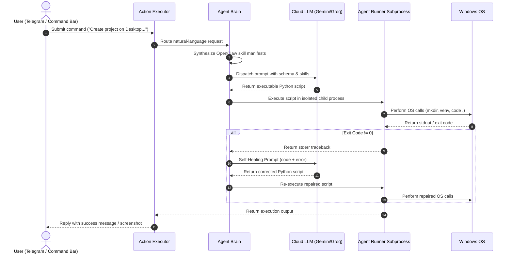

# PRIVACY68 // SYSTEM ARCHITECTURE & COMPONENT DESIGN

```
  █████╗ ██████╗  ██████╗██╗  ██╗██╗████████╗███████╗ ██████╗████████╗██╗   ██╗██████╗ ███████╗
 ██╔══██╗██╔══██╗██╔════╝██║  ██║██║╚══██╔══╝██╔════╝██╔════╝╚══██╔══╝██║   ██║██╔══██╗██╔════╝
 ███████║██████╔╝██║     ███████║██║   ██║   █████╗  ██║        ██║   ██║   ██║██████╔╝█████╗  
 ██╔══██║██╔══██╗██║     ██╔══██║██║   ██║   ██╔══╝  ██║        ██║   ██║   ██║██╔══██╗██╔══╝  
 ██║  ██║██║  ██║╚██████╗██║  ██║██║   ██║   ███████╗╚██████╗   ██║   ╚██████╔╝██║  ██║███████╗
 ╚═╝  ╚═╝╚═╝  ╚═╝ ╚═════╝╚═╝  ╚═╝╚═╝   ╚═╝   ╚══════╝ ╚═════╝   ╚═╝    ╚═════╝ ╚═╝  ╚═╝╚══════╝
```

## 1. Architectural Philosophy

PRIVACY68 is designed around three foundational principles:
1. **Privacy-by-Architecture**: Rather than trusting software toggles on active microphones, the system completely unbinds the PC sound recording hardware. Voice interactions are shifted to out-of-band mobile channels (Telegram) with offline CPU transcription.
2. **Resilient Multi-Provider Intelligence**: Desktop automation cannot tolerate single-point-of-failure API limits. The AI engine implements an automatic fallback cascade across top-tier LLM providers.
3. **Deterministic Self-Healing Execution**: Instead of throwing exceptions on script errors, the execution pipeline catches tracebacks and provides iterative reflection to repair and complete the command.

---

## 2. Multi-Layer Architectural Overview

PRIVACY68 is structured into five distinct operational layers:

```
┌────────────────────────────────────────────────────────────────────────┐
│ 1. INGESTION & INTERFACE LAYER                                         │
│    • Quick Command Bar (ui/ptt_overlay.py) - Hotkey Ctrl+Alt+Space     │
│    • Telegram Remote Gateway (channels/telegram.py) - Global 4G/5G      │
│    • Control Center Dashboard (ui/dashboard/index.html) - WebView2     │
│    • Windows Notification Tray (ui/tray.py)                            │
└───────────────────────────────────┬────────────────────────────────────┘
                                    │
┌───────────────────────────────────▼────────────────────────────────────┐
│ 2. NORMALIZATION & DISPATCH LAYER                                      │
│    • Lexical Autocorrector (speech/streamer.py - vocal tics & prefixes) │
│    • Audio Container Decoder (PyAV / ffmpeg / wav)                     │
│    • Action Executor & Router (actions/executor.py)                    │
│    • OpenClaw Dynamic Skill Registry (skills/skill_registry.py)        │
└───────────────────────────────────┬────────────────────────────────────┘
                                    │
┌───────────────────────────────────▼────────────────────────────────────┐
│ 3. INTELLIGENCE & REASONING LAYER                                      │
│    • Agent Brain Orchestrator (actions/agent_brain.py)                 │
│    • Model Failover Cascader:                                          │
│      Gemini 3.1 Flash-Lite ➔ Groq LPU ➔ Claude 3.5 ➔ OpenAI ➔ Ollama    │
│    • Self-Healing Reflection Engine (Traceback Capture & Repair)       │
└───────────────────────────────────┬────────────────────────────────────┘
                                    │
┌───────────────────────────────────▼────────────────────────────────────┐
│ 4. EXECUTION & ISOLATION LAYER                                         │
│    • Subprocess Agent Runner (actions/agent_runner.py)                 │
│    • Native System Controller (services/system.py)                     │
│    • App Resolution Engine (services/apps.py)                          │
│    • Browser & Gmail Controller (services/gmail.py)                    │
│    • OpenClaw Extensible Skills (skills/*)                             │
└───────────────────────────────────┬────────────────────────────────────┘
                                    │
┌───────────────────────────────────▼────────────────────────────────────┐
│ 5. ENCLAVE & PERSISTENCE LAYER                                         │
│    • Windows Credential Manager DPAPI (utils/credentials.py)           │
│    • Profile Configuration Database (utils/profile_manager.py)         │
│    • SQLite & File State Enclaves                                      │
└────────────────────────────────────────────────────────────────────────┘
```

---

## 3. Component Deep Dive

### A. The Ingestion Layer
- **Quick Command Bar** ([ui/ptt_overlay.py](file:///d:/projects/PRIVACY68/ui/ptt_overlay.py)):
  - Built with native Windows `tkinter` for instantaneous startup ($< 45\text{ms}$).
  - Global hotkey listener on `Ctrl+Alt+Space`.
  - Automatically centers on the active monitor, forces foreground autofocus, and dismisses on `Escape` or outside clicks.
- **Telegram Remote Gateway** ([channels/telegram.py](file:///d:/projects/PRIVACY68/channels/telegram.py)):
  - Polls Telegram Bot API using an asynchronous worker thread.
  - Receives voice messages (OGG/Opus), downloads the file buffer into memory, and passes it to the speech decoding engine without writing raw audio to temporary disk files.
  - Captures execution status, text output, or desktop screenshots, and sends them back to the user's phone.
- **Dashboard Control Center** ([ui/dashboard_runner.py](file:///d:/projects/PRIVACY68/ui/dashboard_runner.py)):
  - Native Windows Edge Chromium engine instantiated via `pywebview`.
  - Full bidirectional JSON-RPC IPC bridge exposed in JavaScript via `window.pywebview.api`.

---

### B. Normalization & Speech Layer ([speech/streamer.py](file:///d:/projects/PRIVACY68/speech/streamer.py))
- **`autocorrect_speech_command(text)`**:
  - Regular expression pipeline that scrubs conversational noise:
    - Strips leading polite particles (*"please"*, *"can you kindly"*, *"alexa"*, *"hey jarvis"*).
    - Removes vocal tics (*"um"*, *"uh"*, *"ah"*, *"hmmm"*).
    - Eliminates stutter repetitions (*"open open Chrome"* $\to$ *"open Chrome"*).
    - Corrects phonetic app misspellings (*"chrom"* $\to$ *"chrome"*, *"notpad"* $\to$ *"notepad"*, *"vs code"* $\to$ *"vscode"*).
- **`decode_audio_bytes_to_pcm(audio_bytes)`**:
  - Three-tiered audio decoding:
    1. Primary: In-memory PyAV (`av.open`) with safety shims for deprecated metadata handlers.
    2. Secondary: Subprocess streaming through `ffmpeg -f s16le -ac 1 -ar 16000 pipe:1`.
    3. Tertiary: Native Python `wave` module with `scipy.signal.resample`.
- **`transcribe_audio_data(audio_data)`**:
  - Removes DC bias offset via mean centering.
  - Applies dynamic peak normalization to 0.95 to maximize acoustic dynamic range.
  - Adds 60ms silence boundary padding to prevent neural phoneme truncation.
  - Transcribes with **Google Web Speech** (online, sub-100ms) with automatic fallback to local **Faster-Whisper int8** (offline).

---

### C. Agent Brain & Execution Flow ([actions/](file:///d:/projects/PRIVACY68/actions/))


---

*Authored by PRN-6 // PRIVACY68 Architecture Reference*
