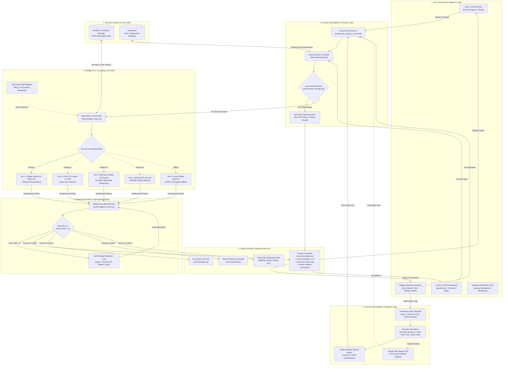
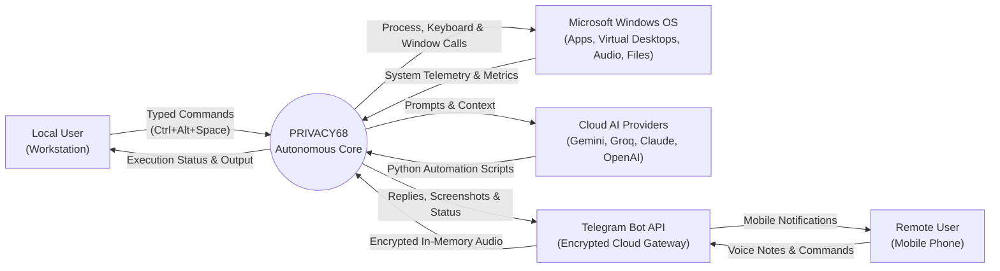
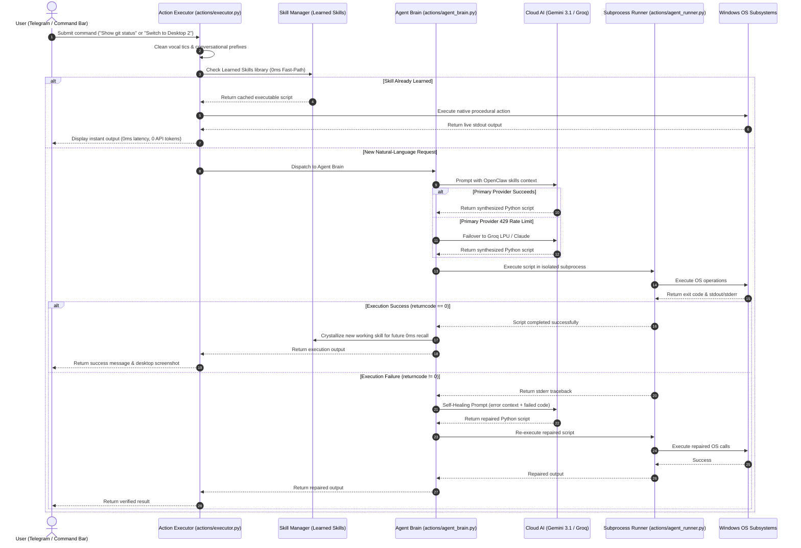

# PRIVACY68 // SYSTEM ARCHITECTURE & DATA FLOW DIAGRAMS

This document contains the complete visual diagram specifications for **PRIVACY68** (Version 1.7.3). All diagrams use standard Mermaid syntax suitable for documentation, Overleaf LaTeX rendering, and presentation slides.

---

## 1. End-to-End System Architecture Diagram

---

## 2. Data Flow Diagram (DFD Level 0 & Level 1)

### DFD Level 0: Context Diagram

---

## 3. Runtime Sequence & Self-Healing Decision Flow

---

## 4. Privacy & Zero-Mic Hardware Isolation Model

```mermaid
flowchart TD
    subgraph Traditional["Commercial Assistants (Siri / Alexa / Cortana)"]
        MIC1["PC Microphone Hardware"] -->|"Continuous Audio Polling (100% Active)"| STREAM1["Background Audio Ring Buffer"]
        STREAM1 -->|"Wake Word Detection ('Hey Siri')"| CLOUD1["Vendor Cloud Infrastructure"]
        STREAM1 -.->|"High False Acceptance Rate (FAR)"| LEAK["Acoustic Telemetry & Privacy Leakage"]
    end

    subgraph Privacy68Model["PRIVACY68 Privacy Architecture"]
        MIC2["PC Microphone Hardware"] ---|"HARDWARE UNBOUND & PERMANENTLY CLOSED"| OFF["Zero Audio Buffer • Zero Mic Access"]
        PHONE["User Mobile Phone (Telegram)"] -->|"Deliberate Voice Note (User Pressed Record)"| ENCR["Telegram Bot API (TLS Encrypted)"]
        ENCR -->|"In-Memory OGG Audio Bytes"| RAM["Host PC Process Memory (RAM)"]
        RAM -->|"PyAV In-Memory Decode (Zero Disk Writes)"| WHISP["Faster-Whisper INT8 (On-Device Local CPU)"]
        WHISP -->|"Text Command String"| EXECUTE["Action Execution Engine"]
    end
```

---

*Authored by PRN-6 // PRIVACY68 Architecture & Data Flow Reference*
