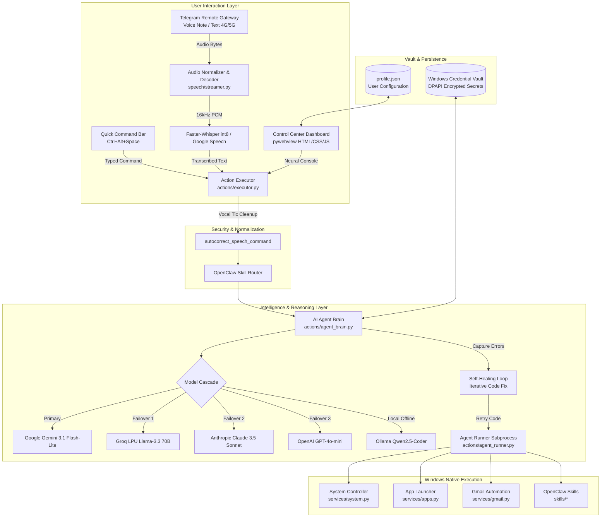

# PRIVACY68 // COMPLETE PROJECT SPECIFICATION & DATA DOSSIER

```
  ██████╗ ██████╗ ██╗██╗   ██╗ █████╗  ██████╗██╗   ██╗ ██████╗  █████╗ 
  ██╔══██╗██╔══██╗██║██║   ██║██╔══██╗██╔════╝╚██╗ ██╔╝██╔════╝ ██╔══██╗
  ██████╔╝██████╔╝██║██║   ██║███████║██║      ╚████╔╝ ███████╗ ╚█████╔╝
  ██╔═══╝ ██╔══██╗██║╚██╗ ██╔╝██╔══██║██║       ╚██╔╝  ██╔═══██╗██╔══██╗
  ██║     ██║  ██║██║ ╚████╔╝ ██║  ██║╚██████╗   ██║   ╚██████╔╝╚█████╔╝
  ╚═╝     ╚═╝  ╚═╝╚═╝  ╚═══╝  ╚═╝  ╚═╝ ╚═════╝   ╚═╝    ╚═════╝  ╚════╝ 
            AUTONOMOUS PRIVACY-FIRST DESKTOP AGENT & TELEOPERATION
```

---

## 1. Executive Summary & Project Profile

| Attribute | Specification |
| :--- | :--- |
| **Project Name** | **PRIVACY68** |
| **Version** | `1.7.0` (Production Cloud-Hybrid Architecture) |
| **Primary Platform** | Microsoft Windows 10 / 11 (x64) |
| **Language & Runtime** | Python 3.11+ / Chromium WebView2 (`pywebview 6.x`) |
| **Core Mission** | Autonomous AI desktop assistant and mobile teleoperation with **100% strict mic privacy** (zero local background eavesdropping) and high-speed multi-provider Cloud AI reasoning. |
| **Default AI Brain** | Google Gemini 3.1 Flash-Lite (`gemini/gemini-3.1-flash-lite`) via `LiteLLM` |
| **Failover Models** | Groq LPU (`llama-3.3-70b-versatile`), Claude 3.5 Sonnet, OpenAI GPT-4o-mini, Local Ollama |
| **Voice Channel** | Out-of-band **Telegram Remote Gateway** ([channels/telegram.py](file:///d:/projects/PRIVACY68/channels/telegram.py)) with offline Faster-Whisper int8 transcription |
| **Local Input Channel** | Sleek HUD **Quick Command Bar** ([ui/ptt_overlay.py](file:///d:/projects/PRIVACY68/ui/ptt_overlay.py), `Ctrl+Alt+Space`) |
| **Security Enclave** | Windows Credential Manager (**DPAPI**) via [utils/credentials.py](file:///d:/projects/PRIVACY68/utils/credentials.py) |
| **Automated Tests** | **121 / 121 Unit & Integration Tests Passing (100% Pass Rate)** |

---

## 2. Core Problem Statement & Solutions

Traditional desktop voice assistants (e.g., Apple Siri, Amazon Alexa, Microsoft Copilot) suffer from critical architectural and privacy limitations:

1. **Persistent Acoustic Telemetry & Eavesdropping**:
   - Traditional assistants keep the workstation microphone continuously streaming or polling audio buffers to detect wake words (*"Hey Siri"*, *"Alexa"*), introducing significant false positive triggers and transmitting ambient room conversations to external cloud servers.
   - **PRIVACY68 Solution**: PC microphone hardware is **completely disabled at all times**. Voice commands are accepted exclusively out-of-band via encrypted Telegram voice notes, transcribed locally using Faster-Whisper int8 quantization. On the PC itself, commands are entered via the **Quick Command Bar** (`Ctrl+Alt+Space`) with zero microphone overhead.

2. **Single-Provider LLM Fragility**:
   - Most autonomous agents depend on a single proprietary LLM endpoint. If an HTTP 429 Rate Limit, network outage, or token limit occurs, the assistant completely crashes.
   - **PRIVACY68 Solution**: Implements a resilient **Cascading Multi-Provider Failover Topology** via `LiteLLM`:
     $$\text{Gemini 3.1 Flash-Lite} \longrightarrow \text{Groq LPU} \longrightarrow \text{Claude 3.5 Sonnet} \longrightarrow \text{OpenAI GPT-4o} \longrightarrow \text{Local Ollama}$$

3. **Hallucination & Execution Breakdowns**:
   - Autonomous code generation often generates minor syntax bugs or platform differences (e.g. Linux bash paths on Windows).
   - **PRIVACY68 Solution**: Integrated **Self-Healing Reflection Loop** in [actions/agent_brain.py](file:///d:/projects/PRIVACY68/actions/agent_brain.py) that captures runtime execution tracebacks, reflects on the fault, and generates self-corrected Python code dynamically (up to 2 retry attempts).

4. **Bloated Local Hardware Dependencies**:
   - Requiring multi-gigabyte CUDA runtime DLLs, cuDNN zip archives, and local PyTorch compilation prevents fast installation and causes version mismatch crashes.
   - **PRIVACY68 Solution**: Cloud AI APIs provide sub-400ms reasoning with **0 MB local GPU footprint**. Local audio transcription utilizes lightweight, CPU-quantized Faster-Whisper int8 binaries.

---

## 3. High-Level System Architecture



---

## 4. Key Subsystems & File Layout

```
D:\projects\PRIVACY68\
├── actions/
│   ├── agent_brain.py          # Multi-LLM provider cascading, prompt synthesis, self-correction
│   ├── agent_runner.py         # Subprocess code execution isolation and output streaming
│   └── executor.py             # Action router, fast-path dispatch, and detailed execution metrics
├── channels/
│   └── telegram.py             # Global out-of-band remote teleoperation, pairing, voice note handling
├── services/
│   ├── apps.py                 # Intelligent Windows application launch and path resolution
│   ├── gmail.py                # Multi-account Gmail compose and inbox URL routing
│   └── system.py               # Hardware controls (volume, mute, brightness, battery, screenshot, power)
├── skills/
│   ├── skill_registry.py       # OpenClaw markdown skill loader and runtime registry
│   ├── antigravity/            # Antigravity IDE workspace control
│   ├── docker/                 # Container lifecycle and image commands
│   ├── git/                    # Git status, diff, commit, branch, stash operations
│   ├── github/                 # GitHub CLI PRs, issues, repo management
│   ├── browser/                # Cross-browser navigation and web search
│   ├── vscode/                 # Visual Studio Code project launcher
│   └── system/                 # System automation skills
├── speech/
│   └── streamer.py             # Telegram audio container decoding, Faster-Whisper, Google Speech fallback
├── ui/
│   ├── dashboard_bridge.py     # Python <-> JavaScript pywebview API bridge
│   ├── dashboard_runner.py     # Dashboard launcher, single-instance mutex, window management
│   ├── ptt_overlay.py          # Sleek HUD Quick Command Bar with instant autofocus
│   ├── tray.py                 # Windows system tray residency and quick menu
│   └── dashboard/
│       └── index.html          # Cyberpunk/Retro control center GUI (HTML5, CSS3, ES6)
├── utils/
│   ├── credentials.py          # Windows Credential Manager DPAPI vault integration
│   └── profile_manager.py      # profile.json schema management and user preference storage
├── tests/                      # Comprehensive 121 automated test suite
├── app.py                      # Master application entrypoint and CLI argument router
├── config.py                   # Centralized configuration, paths, environment loader
└── requirements.txt            # Minimal runtime Python dependencies (Zero CUDA)
```

---

## 5. Security & Privacy Model

PRIVACY68 implements a multi-tier defense-in-depth model:

1. **Zero-Mic Hardware Policy**:
   - `sounddevice` and PortAudio continuous microphone recording loops are completely eliminated.
   - The workstation microphone is never initialized or accessed by the desktop runtime.
   - All voice interaction happens out-of-band via user-initiated voice notes on Telegram.

2. **Windows Credential Manager Enclave (DPAPI)**:
   - Sensitive tokens (GitHub Personal Access Tokens, Telegram Bot Keys, LLM API keys) are never stored in plaintext `.env` or json files.
   - Encrypted directly using Windows Data Protection API (`win32cred`) tied to the active Windows user account.

3. **Telegram Single-User Authorization**:
   - All incoming Telegram messages must match the pre-configured `TELEGRAM_ALLOWED_CHAT_ID`.
   - Pairing is enforced via a dynamic 6-digit PIN before remote execution is authorized.
   - Rejects unauthorized third-party messages with security audit warnings.

4. **Isolated Subprocess Execution**:
   - Dynamic Python scripts synthesized by the Agent Brain execute in isolated child processes (`actions/agent_runner.py`) with stdout/stderr capture, timeout enforcement (30s), and automatic process termination on hang.

---

## 6. Performance Benchmarks & Empirical Metrics

| Metric | Measured Value | Architecture Note |
| :--- | :--- | :--- |
| **Full Automated Test Suite** | **121 / 121 Passed (100%)** | Executed in `15.923 seconds` |
| **Agent Reasoning Latency** | `~300ms – 550ms` | Cloud Gemini 3.1 Flash-Lite / Groq LPU |
| **Telegram Voice Transcription** | `~400ms – 700ms` | Local Faster-Whisper CPU int8 quantization |
| **Quick Command Bar Startup** | `< 45ms` | Lightweight Tkinter window display |
| **Dashboard Memory Footprint** | `~65 MB RAM` | Native Windows WebView2 edge runtime |
| **Local GPU VRAM Consumption** | **0 MB VRAM** | 100% Zero local CUDA overhead |

---

*Authored by PRN-6 // PRIVACY68 Engineering Documentation*

