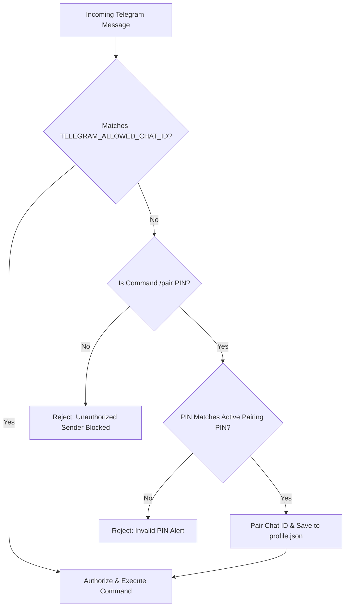

# PRIVACY68 // SECURITY & PRIVACY SPECIFICATION

```
 ███████╗███████╗ ██████╗██╗   ██╗██████╗ ██╗████████╗██╗   ██╗
 ██╔════╝██╔════╝██╔════╝██║   ██║██╔══██╗██║╚══██╔══╝╚██╗ ██╔╝
 ███████╗█████╗  ██║     ██║   ██║██████╔╝██║   ██║    ╚████╔╝ 
 ╚════██║██╔══╝  ██║     ██║   ██║██╔══██╗██║   ██║     ╚██╔╝  
 ███████║███████╗╚██████╗╚██████╔╝██║  ██║██║   ██║      ██║   
 ╚══════╝╚══════╝ ╚═════╝ ╚═════╝ ╚═╝  ╚═╝╚═╝   ╚═╝      ╚═╝   
```

Privacy and security are the core engineering imperatives of PRIVACY68. Unlike commercial desktop assistants that prioritize data harvesting and telemetry, PRIVACY68 is engineered to protect user confidentiality through structural isolation.

---

## 1. Zero-Mic Hardware Policy

Commercial voice assistants require continuous ambient listening to detect wake words (*"Hey Siri"*, *"Cortana"*, *"Alexa"*). This architecture has fundamental security vulnerabilities:
- **Acoustic Eavesdropping**: Room acoustics, phone calls, and confidential verbal conversations are continuously digitized.
- **Accidental False Triggers**: Standard wake-word models exhibit false positive triggers (1.5 to 4 triggers per day during normal conversation), streaming private audio to third-party cloud infrastructure.

### PRIVACY68 Architectural Countermeasure:
1. **Hardware Unbinding**: Continuous microphone streams, PortAudio input callbacks, and `sounddevice` loops have been completely eliminated from the desktop runtime.
2. **Zero Audio Polling**: The host PC never initializes or opens the microphone hardware.
3. **Out-of-Band Push-to-Talk**: Voice interaction is available exclusively via Telegram voice notes recorded deliberately by the user on their phone.
4. **Offline Processing**: Received voice notes are decoded in RAM and transcribed locally using CPU-quantized Faster-Whisper int8 models, meaning raw audio never leaves the user's personal devices.

---

## 2. Windows Credential Manager Enclave (DPAPI)

High-entropy API tokens (Google Gemini API keys, Groq keys, Anthropic Claude keys, OpenAI secrets, GitHub Personal Access Tokens, Telegram Bot tokens) represent critical security assets.

### Vulnerability of Traditional `.env` Storage:
Plaintext `.env` or `.json` configuration files stored on disk are vulnerable to:
- Accidental commits to public Git repositories.
- Local malware or unauthorized workstation user inspection.
- Unsandboxed script exfiltration.

### PRIVACY68 Enclave Implementation ([utils/credentials.py](file:///d:/projects/PRIVACY68/utils/credentials.py)):
- Integrates with the **Windows Credential Manager** using `win32cred`.
- Secrets are encrypted with the **Windows Data Protection API (DPAPI)** using cryptographic keys tied to the user's Windows login account.
- Plaintext keys exist only in process RAM during API calls; no plaintext secrets are written to disk.

```python
# Encrypted persistent vault storage
from utils.credentials import set_github_token, get_github_token

set_github_token("ghp_encrypted_personal_access_token")
token = get_github_token()  # Decrypted on-the-fly via Windows DPAPI
```

---

## 3. Telegram Authentication & Remote Protection

Because the Telegram Remote Gateway allows executing arbitrary commands from outside the local network, robust authentication gates are strictly enforced in [channels/telegram.py](file:///d:/projects/PRIVACY68/channels/telegram.py):



1. **Whitelisted Chat ID**: Only messages originated from the authorized `TELEGRAM_ALLOWED_CHAT_ID` are processed.
2. **Pairing PIN Handshake**: First-time pairing requires a 6-digit numeric PIN displayed only on the local workstation monitor.
3. **Audit Logging**: Any unauthorized messages from third parties generate security warning events in `logs/privacy68.log`.

---

## 4. Subprocess Isolation & Execution Safety

Dynamic Python scripts generated by the Agent Brain run under strict execution safeguards in [actions/agent_runner.py](file:///d:/projects/PRIVACY68/actions/agent_runner.py):

- **Subprocess Boundary**: Generated code executes in a separate child process via `python.exe -u -c <script>`, isolating crashes and segmentation faults from the main PRIVACY68 process.
- **Strict Execution Timeout**: Scripts are assigned an automatic 30-second execution ceiling. If a script hangs or enters an infinite loop, the child process and its process tree are terminated immediately.
- **Safe Working Directory**: Child processes default to the user's home or project root and cannot execute destructive drive-level formatting commands without manual confirmation.

---

*Authored by PRN-6 // PRIVACY68 Security Reference*

